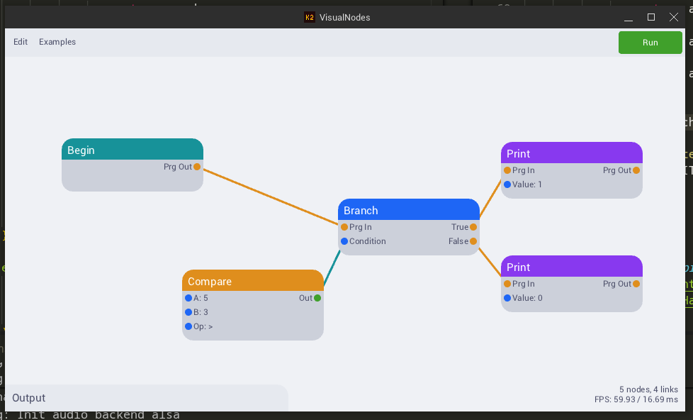

# Visual Nodes
This is a Visual Node Editor with a graph runner built in.
It is similar to Unreal Engine's Blueprints and Blender's geometry nodes.
You create runnable algorithms by arranging and linking visual node blocks in a manner.

# Tech Stack
- [Odin Lang](https://odin-lang.org/)
- [Karl2D](https://github.com/karl-zylinski/karl2d): Windowing, drawing and input library.
- [Clay](https://github.com/nicbarker/clay): Layout library used for UI.

# Web Demo
https://visualnodes.erenay.me

# Usage / Layout
#### Top Bar:
- You can load example graphs using the Examples menu.
- You can run the current graph using the Run button.

#### Output Box:
Shows the last execution time, duration and program output.

#### Stats Box:
Shows some technical statistics (FPS, Frame Time, graph size).

#### Canvas
The biggest middle part of the whole UI. This is where nodes and links live in.

### Controls:
- Left Click and Drag: Move nodes
- Right Click on Canvas: Open context menu for adding nodes
- Right Click on Node: Open context menu for deleting
- Hold Left Alt + Right Click and Drag: Cut/Delete links between nodes
- Left Click on Pin and Drag to another Pin: Create a link between nodes
- Left Click on Input Pin Label: Edit the value of the input pin

# Doing a native build
1. Get the [Odin Compiler](https://odin-lang.org/docs/install/)
2. Clone or download this repository (`git clone https://github.com/erenaywastaken/VisualNodes.git`)
3. Navigate to the repo root (`cd VisualNodes/`)
4. Build & run (`odin run src/`)

# Reflection
I had always wanted to do a project like this as it seemed very interesting as an idea. My first try was with Typescript but i hit some roadblocks on that and stopped working on the project. This is my second try on the idea using a systems programming language this time. And I am happy that I was able to finish it. I had a lot of fun writing it and exercised a lot of my data structures & algorithms knowledge.